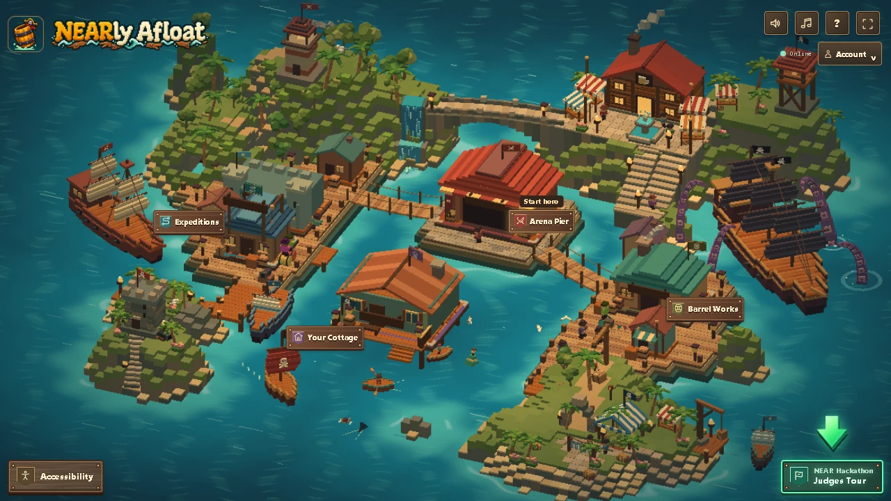

# NEARly Afloat

NEARly Afloat is a multiplayer pirate barrel brawler. Knock opponents off a floating arena, equip a barrel with different handling, trade gear at Barrel Works, or pool GOLD to bring back treasure. Built for the **NEAR Hackathon**, with a hosted **NEAR testnet** economy.

**Games With Real Economies** and **Social Money** are demonstrated in the live game. **AI Security & Defense** and **Agent Economy** use a separately deployed merchant-agent rehearsal.

[Play the hosted demo](https://nearly-afloat-production.up.railway.app/) · [Judges' guide and evidence](docs/JUDGES-GUIDE.md) · [Screening checklist](AGENTS.md)



## Try the hosted game

1. Open **Arena Pier → Training** for a guest match. Use WASD, arrow keys or the floating touch joystick. The last barrel afloat wins. Finish your first eligible match to unlock the starter offer in the bay.
2. Sign in through **Account** with Google or email. Claim the starter or buy an upgrade in **Barrel Works**. Open **Your Cottage → Gear** to equip an owned barrel.
3. Choose **Arena Pier → Play → Plunder Pot**, review the displayed entry price and play. Open **Your Cottage → Logbook** to see the round's activity. Reload to verify the same account, gear and balance.
4. Open **Judges Tour → Expeditions rehearsal** to fund a voyage from two demo crews, open the auction, settle and equip the treasure. Reviewers advance each stage on a separate testnet contract. The normal Expeditions building currently displays the settled player voyage.

The green **Judges Tour** sign opens a welcome screen and a checklist. **Back to Judges Tour** marks an in-game stop as visited. All labs are available on the hosted site. Impact Lab uses a solo game-server room. [Trap Lab](https://nearly-afloat-production.up.railway.app/trap-lab.html) and [Bot Lab](https://nearly-afloat-production.up.railway.app/trap-lab.html?mode=bots) run their simulations in the browser.

## Play locally

Use Node.js 22.22.2 or newer. Run from the repository root.

```sh
npm ci
npm test
npm run build
npm start
```

Open [localhost:4182](http://127.0.0.1:4182/). The default server uses SQLite at `data/economy.sqlite` and works without wallet or cloud credentials. Each fresh browser profile gets 100 local test gold. This mode has its own inventory interface. The hosted GOLD build uses the barrel and color chooser backed by the signed-in testnet account.

## What NEAR does

- The fixed-supply NEP-141 GOLD token backs the spendable testnet ledger. The Arena contract holds deposited tokens and records trade, equipment, durability, scrap, and voyage awards. A referee settles the game server's match result.
- Privy Google/email sign-in uses a user-owned embedded wallet. Normal game actions use a scoped spending key. The browser can remember the account for seven days. The spending key expires after up to eight hours and can be renewed separately.
- Voyage funding comes from multiple contributors. The auction releases outbid funds, awards cargo to the highest bidder, and distributes net proceeds in proportion to each contribution.
- A rule-based merchant agent buys, waits, and sells under a scoped key and contract policy. The isolated testnet rehearsal used scripted demand. Its cycle cost 2.51 GOLD. The merchant worker is inactive on the game host.

```sh
node scripts/verify-gold-agent-evidence.mjs
node scripts/verify-judges-expedition.mjs
```

These read-only checks use public testnet receipts and state. The [track evidence](docs/JUDGES-GUIDE.md#track-evidence) also links the normal campaign's 80 GOLD human sale.

## Source and licenses

| Path | Contents |
| --- | --- |
| `src/`, `public/` | Game client, scenes, interface and original assets |
| `shared/`, `server.mjs`, `economy.mjs` | Shared game rules, multiplayer server and local ledger |
| `near-arena/`, `near-gold/`, `near-expeditions/` | Unified Arena, GOLD token and historical standalone voyage contracts |
| `test/`, `scripts/` | Game tests, contract rehearsals and public verifiers |

Software and technical documentation use the [PolyForm Shield License 1.0.0](LICENSE). [NOTICE](NOTICE) and the [original asset permissions](ASSETS-LICENSE.md) cover review by humans and screening tools. Original artwork, music, and sounds were created for this project. Development was AI-assisted.

Third-party software retains its own licenses. Three.js, ws and jose use MIT. near-api-js uses MIT AND Apache-2.0. NEAR Connect uses MIT. The Privy core SDK uses Apache-2.0. Vite uses MIT. The Rust contracts use near-sdk and near-contract-standards under MIT OR Apache-2.0. The build generates `dist/THIRD-PARTY-NOTICES.txt`.
