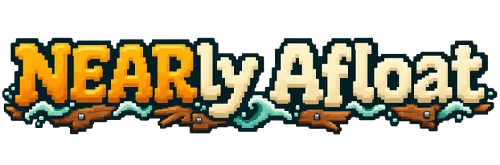
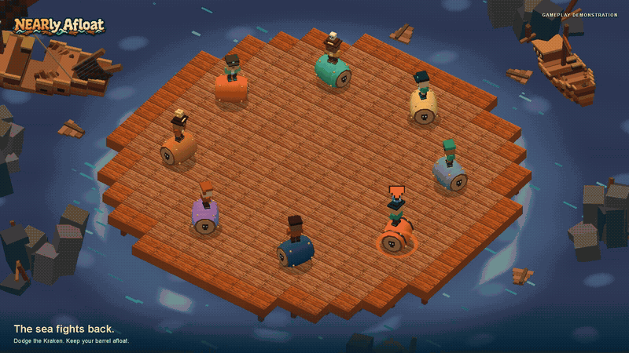
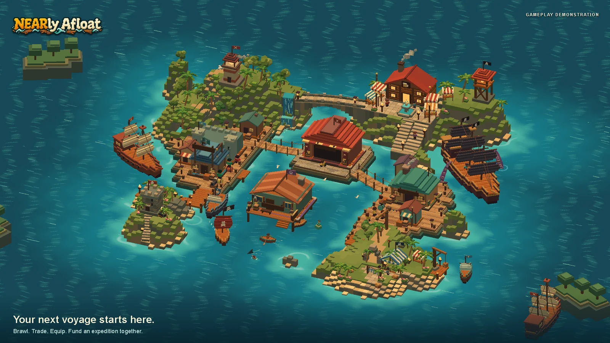
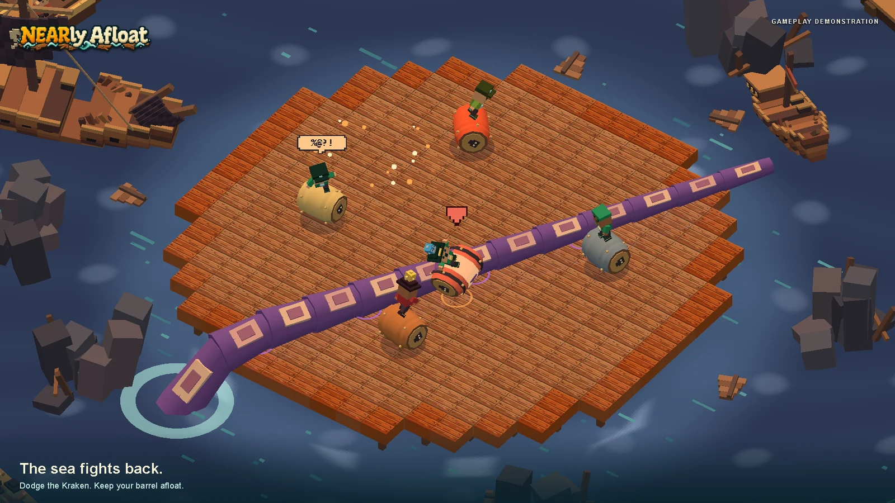
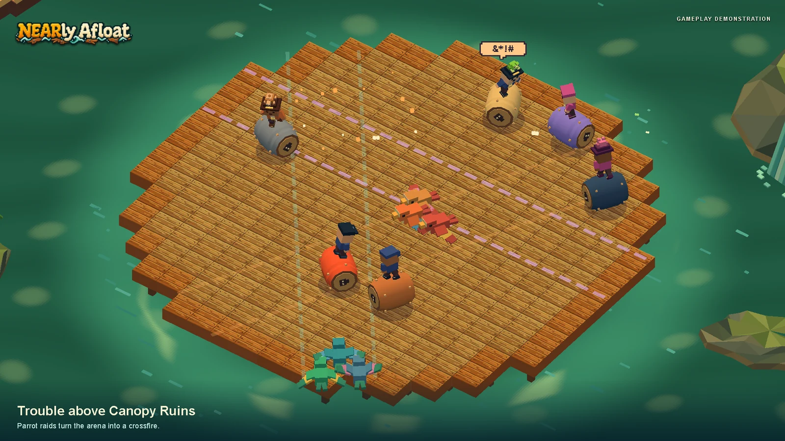
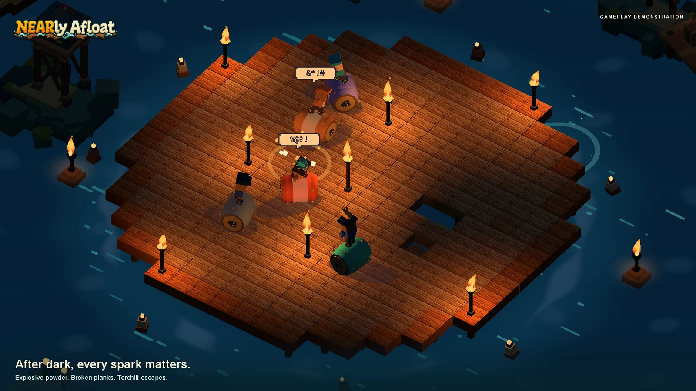

<p align="center">
  
</p>

# NEARly Afloat

<p align="center">
  <strong>Welcome aboard, buccaneers. Last barrel afloat wins.</strong><br>
  Brawl on a shrinking deck. Trade and equip your gear. Fund the next voyage with your crew.
</p>

<p align="center">
  <a href="https://nearly-afloat-production.up.railway.app/"><strong>⚓ Play in your browser</strong></a> ·
  <a href="https://x.com/LeinedD/status/2121723268059333071"><strong>🎬 Watch the demo</strong></a> ·
  <a href="docs/JUDGES-GUIDE.md"><strong>🧭 Judges' guide & evidence</strong></a>
</p>

<p align="center">
  Built at <strong>NEAR HACKATHON 2026</strong> · Desktop & touch controls · Hosted economy on <strong>NEAR testnet</strong>
</p>

[](https://x.com/LeinedD/status/2121723268059333071)

**[Watch the 70-second demo on X](https://x.com/LeinedD/status/2121723268059333071)** · **[Download the Full HD video](https://github.com/dlb93la/nearly-afloat-hackathon/releases/download/demo-2026-11-14/NEARly-Afloat-Demo-FullHD-60fps.mp4)**

## A little deck. A lot of trouble.

NEARly Afloat is a multiplayer pirate barrel brawler. Knock rivals into the sea while the arena shrinks beneath you. Cannons fire, parrots swoop, anchors punch through the planks, and the Kraken has no respect for personal space. Some rounds tilt the whole deck; others leave you fighting by torchlight.

Back in the bay, choose a barrel with different handling, browse the merchant's stock, and make your cottage your own. Or join a crew-funded expedition: bring treasure home, auction it, and share the net sale proceeds according to each pirate's contribution.

<table>
  <tr>
    <td width="50%"><br><strong>Your next voyage starts here.</strong></td>
    <td width="50%"><br><strong>The sea fights back.</strong></td>
  </tr>
  <tr>
    <td width="50%"><br><strong>Trouble above Canopy Ruins.</strong></td>
    <td width="50%"><br><strong>After dark, every spark matters.</strong></td>
  </tr>
</table>

The demo uses controlled scenarios from the real game engine, followed by evidence summaries. Its 60 fps recording is not a device-performance benchmark. The expedition sale is a recorded player transaction; the agent segment describes an isolated rehearsal.

## Pick your adventure

| Mode | What to expect |
| --- | --- |
| **Training** | Practice against bots. No entry fee, equipment wear or repeat GOLD rewards. |
| **For Fun** | Play with online pirates and bots filling the crew. No entry fee or GOLD rewards. Friend rooms are also reward-free. |
| **Plunder Pot** | Put down the displayed GOLD entry, bring your equipped barrel and compete for the pot. Entries, settlements and refunds use the hosted testnet economy. |

**Start playing:** open [Arena Pier → Training](https://nearly-afloat-production.up.railway.app/). Steer with **WASD**, **arrow keys** or the **floating touch joystick**. The last barrel afloat wins. Your first eligible completed match unlocks a starter offer back in the bay; winning is not required.

## Around the bay

| Destination | Your next move |
| --- | --- |
| **Arena Pier** | Train, join For Fun or enter Plunder Pot. |
| **Barrel Works** | Buy and sell gear with the merchant. Stock affects prices; find barrels with different handling and choose your look. |
| **Your Cottage** | Equip owned gear, customize your space and read the Logbook. |
| **Expeditions** | Fund a shared voyage, auction its treasure and divide the net proceeds. The normal building currently displays the settled player voyage. |

Google or email sign-in lives in **Account**. Normal game actions use scoped spending permission, keeping repeated wallet confirmations out of the game loop.

## Taking the judges' tour?

Open the green **Judges Tour** sign in the bay for a welcome screen, route checklist and controlled labs. Choose **Back to Judges Tour** to return and mark a stop as visited.

1. **Play a round:** finish Training as a guest.
2. **Try the economy:** sign in, claim the starter or buy gear at Barrel Works, equip it in Cottage → Gear, then play Plunder Pot. Check Cottage → Logbook and reload to verify account, equipment and balance persistence.
3. **Rehearse an expedition:** fund 20 and 10 GOLD from the two demo crews, advance the stages, bid, settle and equip the cargo. This route uses a separate testnet contract and shared demo crews, with manual stage controls. It is distinct from the recorded player sale.
4. **Inspect the agent:** open the finalized trades, spending policy and rejected requests. The worker is inactive on the game host; its evidence comes from the isolated run described below.

[Full walkthrough & receipts](docs/JUDGES-GUIDE.md) · [Screening instructions](AGENTS.md) · [Trap Lab](https://nearly-afloat-production.up.railway.app/trap-lab.html) · [Bot Lab](https://nearly-afloat-production.up.railway.app/trap-lab.html?mode=bots)

All labs are available online. Impact Lab uses a solo server room. Trap Lab and Bot Lab simulate in the browser, including some earlier experimental traps.

## Run your own local game

Use **Node.js 22.22.2 or newer**, then run from the repository root:

```sh
npm ci
npm test
npm run build
npm start
```

Open **[localhost:4182](http://127.0.0.1:4182/)** in a browser with WebGL.

The default server works without wallet or cloud credentials. It uses a separate SQLite ledger at `data/economy.sqlite`; each fresh browser profile gets 100 local test gold. This local mode has its own inventory interface. The hosted GOLD build uses the barrel and color chooser backed by the signed-in testnet account. Local play is not an on-chain economy proof.

## What NEAR makes possible

| Track | Implemented behavior | Where to check |
| --- | --- | --- |
| **Games With Real Economies** | A fixed-supply NEP-141 GOLD token backs deposited balances. The Arena contract records merchant trades, equipment, durability, scrap and voyage awards. A referee settles the game server's match result. | [Play the game](https://nearly-afloat-production.up.railway.app/) · [Implementation & receipts](docs/JUDGES-GUIDE.md#track-evidence) |
| **Social Money** | Players contribute to a voyage. Outbid funds are released; the highest bidder receives the cargo, and contributors share net sale proceeds. | [Recorded 80 GOLD player sale](https://testnet.nearblocks.io/txns/69MgkKyCqNVAedNaPESc1k5sz6qG6KMzDLJmKF8A7Lhf) · [Evidence](docs/evidence/expedition-human-sale-2026-11-14.json) |
| **AI Security & Defense** | A delegated merchant-agent key and contract policy constrain receiver, method, item, spend, sequence, expiry and revocation. | [Policy, trades & rejection evidence](https://nearly-afloat-production.up.railway.app/proofs/agent.html) |
| **Agent Economy** | A rule-based agent with its own testnet GOLD bought, waited and sold within its policy, under scripted demand. | [Isolated run](docs/evidence/agent-gold-testnet.json) · [Read-only verifier](scripts/verify-gold-agent-evidence.mjs) |

**One voyage, checked on-chain:** two players contributed **20 + 10 GOLD**. The cargo sold for **80 GOLD**. A **4 GOLD fee** left **76 GOLD**, paid as **50.67 + 25.33 GOLD**. These are shares of the sale proceeds, not guaranteed returns. The Gilded Parrot is an equippable inventory award, not an NFT.

**Agent evidence has limits:** its scripted cycle bought for **5.63 GOLD** and sold for **3.12 GOLD**, costing **2.51 GOLD**. It demonstrates bounded execution, not profitable trading or improved market availability. The merchant worker is inactive on the hosted game.

Verify the public testnet evidence without operator keys:

```sh
node scripts/verify-gold-agent-evidence.mjs
node scripts/verify-judges-expedition.mjs
```

Privy provides Google/email sign-in with a user-owned embedded wallet. The browser can remember the account for seven days; the scoped spending key has a separate lifetime of up to eight hours and can be renewed. Match results remain authoritative on the game server. See the [judges' guide](docs/JUDGES-GUIDE.md#reproduction-and-limits) for configuration and operational limits.

## Source, credits & permissions

| Path | Contents |
| --- | --- |
| `src/`, `public/` | Game client, scenes, interface and original assets |
| `shared/`, `server.mjs`, `economy.mjs` | Shared game rules, multiplayer server and local ledger |
| `near-arena/`, `near-gold/`, `near-expeditions/` | Unified Arena, GOLD token and historical standalone voyage contracts |
| `test/`, `scripts/` | Game tests, contract rehearsals and public verifiers |

Software and technical documentation use the [PolyForm Shield License 1.0.0](LICENSE). [NOTICE](NOTICE) and the [original asset permissions](ASSETS-LICENSE.md) cover review by humans and screening tools. Original artwork, music and sounds were created for this project. Development was AI-assisted.

Third-party software retains its own licenses. Three.js, ws and jose use MIT. near-api-js uses MIT AND Apache-2.0. NEAR Connect uses MIT. The Privy core SDK uses Apache-2.0. Vite uses MIT. The Rust contracts use near-sdk and near-contract-standards under MIT OR Apache-2.0. The build generates `dist/THIRD-PARTY-NOTICES.txt`.

<p align="center"><strong>Fair winds, buccaneer. Try to keep the barrel dry.</strong><br><a href="https://nearly-afloat-production.up.railway.app/">Set sail →</a></p>
