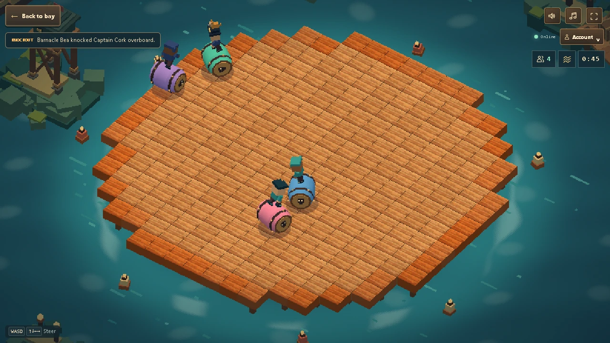

# Judges' guide

[Play](https://nearly-afloat-production.up.railway.app/) · [Running build](https://nearly-afloat-production.up.railway.app/build-info.json)

[Watch the 70-second demo](https://x.com/LeinedD/status/2121723268059333071) · [Download the Full HD recording](https://github.com/dlb93la/nearly-afloat-hackathon/releases/download/demo-2026-11-14/NEARly-Afloat-Demo-FullHD-60fps.mp4)



## What to try

| Start here | Action | Expected result |
| --- | --- | --- |
| Arena Pier → Training | Try a guest match. Steer with WASD, arrow keys or the touch joystick. | A single winner and a result screen. The first eligible match unlocks a starter offer. Training has no entry, equipment wear or repeat GOLD rewards. |
| Account → Sign in | Enter with Google or email. Buy an upgrade in Barrel Works and equip it in Cottage → Gear. Play a solo Plunder Pot round and open Cottage → Logbook. Reload. | Stock reflects the sale, your equipment appears on the barrel, and the paid round records entry and settlement. The same account, gear and balance return. |
| Judges Tour → Expeditions rehearsal | Fund 20 and 10 GOLD using the two demo crews. Sail, open the auction, bid 70 then 80, settle and equip the treasure. | The earlier bid is released. The 80 GOLD sale yields a 4 GOLD fee and 76 for contributors. The buyer receives the treasure. |
| Judges Tour → Agent & spending limits | Open the buy, sell and rejection receipts or run the public verifier below. | Two finalized trades and rejected requests that fell outside the key or contract spending policy. |

The green Judges Tour sign opens the welcome screen and checklist. Choose **Back to Judges Tour** to mark a stop as visited. Impact Lab, Trap Lab and Bot Lab expose controlled scenarios and bot styles without changing player balances.

[Trap Lab](https://nearly-afloat-production.up.railway.app/trap-lab.html) gives all eleven traps their own buttons. Depending on the trap, adjust warning time, direction, impact width, number of objects or paths, fuse, crane speed or starting tilt. The earlier swinging anchor and hanging crate remain available. [Bot Lab](https://nearly-afloat-production.up.railway.app/trap-lab.html?mode=bots) runs a separate full round with the selected bot behavior. Both pages are hosted, with simulation running in the browser. Impact Lab opens inside the hosted game.

The Expeditions rehearsal uses a dedicated testnet contract, token and shared demo crews. Use **Start another rehearsal** if the previous one is complete. Advance each stage using the available buttons. The normal Expeditions building displays the settled player voyage until a referee opens a new campaign.

## Track evidence

| Track | Demonstration | Verification |
| --- | --- | --- |
| Games With Real Economies (`games`) | Inventory and stock, equipped handling, paid entry, settlement and refunds. The project owner confirmed the hosted Google and game economy cycle on Android. | [Hosted gameplay](https://nearly-afloat-production.up.railway.app/) · [Historical winner payout](https://testnet.nearblocks.io/txns/EQExZtZGt4BFLMpZzALhXMa6GYikzwff5sEUQ91RLbgQ) · [Historical refund](https://testnet.nearblocks.io/txns/A2UQrvg4vPxudHFkzXnedfaa6Z1wkhScDq3bSZA2B1CT) |
| Social Money (`social`) | Two player accounts funded campaign 4 with 20 and 10 GOLD. The 80 GOLD sale paid 4 in fees and returned 50.67 and 25.33 to the contributors. The winner equipped the Gilded Parrot. | [Final settlement](https://testnet.nearblocks.io/txns/69MgkKyCqNVAedNaPESc1k5sz6qG6KMzDLJmKF8A7Lhf) · [Recorded balances and equipment](evidence/expedition-human-sale-2026-11-14.json) · [Isolated judges' rehearsal](evidence/judges-expedition-2026-11-14.json) |
| AI Security & Defense (`security`) | The agent's delegated key is limited to the Arena contract and its trade method. Contract rules constrain item, per-trade and cumulative spend, order, expiry and revocation. | [Policy and finalized receipts](https://nearly-afloat-production.up.railway.app/proofs/agent.html) · [Evidence JSON](evidence/agent-gold-testnet.json) |
| Agent Economy (`agents`) | A rule-based agent with its own GOLD balance bought for 5.63 GOLD, waited, then sold for 3.12 GOLD under scripted demand. The net cost was 2.51 GOLD. | [Agent proof](https://nearly-afloat-production.up.railway.app/proofs/agent.html) · Read-only verifier below |

The agent is rule-based and its merchant worker is inactive on the hosted game. The isolated run proves bounded execution under scripted demand. Stock improvement and profitability remain unproven. Voyage awards are game inventory records and GOLD is a transferable NEP-141 token.

## Implementation map

- `server.mjs` runs authoritative matches and the Arena contract settles the referee's result. `shared/simulation.mjs` also powers the offline labs.
- Social solo paid entry checks cached funds and places an account-wide server hold before starting the full countdown. Authorization, reservation and settlement continue in the background. Rematches keep independent outcomes and ordered authorizations. A failed or conflicting entry is cancelled/reconciled without a paid reward; only a confirmed settlement records a payout. There is no blockchain wait inside the running match.
- `near-arena` implements the paid arena, equipment, durability, shared deposited balance and voyages. `near-gold` implements GOLD. `near-expeditions` contains the earlier standalone voyage contract.
- `near-social.mjs` and `near-embedded.mjs` separate social identity from spending permission. A remembered account can survive a restart for seven days. The server enforces an eight-hour ceiling and a 10,000 test-GOLD spending limit per signing session. Logout ends the server session. The NEAR function-call key remains registered with its receiver, allowed methods and gas allowance. The merchant agent has its own policy enforced by the contract.
- `src/near-workshop.js` renders the testnet inventory and the Cottage barrel and color chooser. The credential-free local build has its own SQLite economy and inventory.

## Reproduction and limits

Use Node.js 22.22.2 or newer. Follow the [local setup](../README.md#run-your-own-local-game) and run the two checks below after `npm ci`.

```sh
node scripts/verify-gold-agent-evidence.mjs
node scripts/verify-judges-expedition.mjs
```

Both checks read public testnet receipts and state. For the agent verifier, `AFLOAT_AGENT_RPC` selects an alternative testnet RPC with transaction history. The judges' expedition verifier uses FastNEAR directly. See the [Arena WASM and contract tests](../near-arena/README.md) and [standalone voyage contract tests](../near-expeditions/README.md).

The identifier at `/build-info.json` hashes the frontend inputs listed in `vite.config.js`. Path separators and text line endings affect that identifier, so a Windows checkout can produce a different ID from the Linux host. For source comparisons, record the Git commit and compare the input files. Backend code, runtime configuration and assets under `public/` require separate checks.

### Run your own GOLD environment

1. Build the `near-gold` and `near-arena` WASMs with the `wasm32-unknown-unknown` target. Deploy to your own testnet accounts and initialize the Arena with `new_with_gold` and the GOLD token account.
2. Register the Arena account with the token and fund the Arena reserves and token sale. Use funded testnet operator accounts with function-call keys scoped to the required methods. Set the hosted configuration names from `config/deploy.example` and validate the live configuration with `npm run deploy:check`.
3. For social sign-in, configure a Privy app with Google and/or email, identity tokens and the exact HTTPS origin. Use the same origin for the public server and embedded callback. Keep operator keys on the server and set a persistent directory for SQLite.
4. Configure the optional judge rehearsal with a separate token, contract build using the `judges-demo` feature and dedicated demo crews. The public evidence verifier and ordinary test suite run without deploying anything.

The hosted game requires WebGL. Safari can restrict web fullscreen and orientation locking. Rotate manually or use a Home Screen web app in that case. If testnet balance reads slow down, the account remains signed in and the game retries in the background. Training and For Fun remain available while the balance loads.

## Independent review

Open the hosted game in a fresh browser profile, then execute the local setup using only this repository. Check the Workshop, the Cottage and the paid Arena using your own test account. Run both public verifiers. For each mismatch, record the build, exact steps, expected and actual behavior, and a screenshot or receipt. Flag issues that prevent running the game, completing the economy flow or verifying an entry claim first. [Official rules and screening procedure](https://nearhackathon.com/HACKATHON.md)
